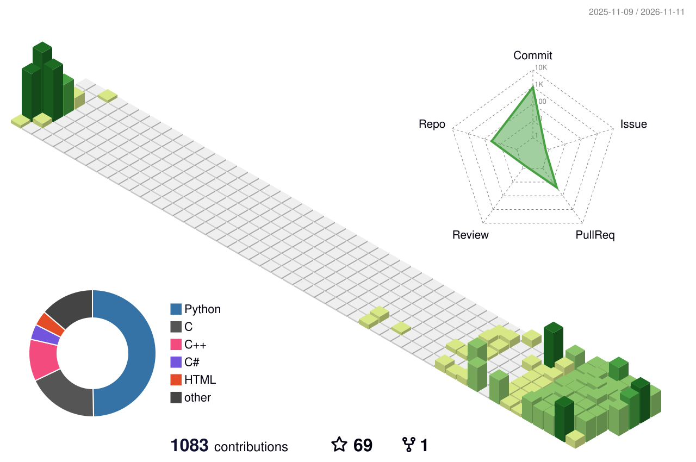

# Shashwat Aneja

**Software Engineering · Interactive Systems · Embedded Development**

Building useful products, connected devices, and immersive experiences.

## Selected work

<table align="center">
<tr><td width="50%" valign="top">
<strong><a href="https://github.com/Shashwat-Aneja/Xylo-business-automation-suite">XYLO</a></strong>

Business automation and accounting Python · Backend

</td><td width="50%" valign="top">
<strong><a href="https://github.com/Shashwat-Aneja/WIZARD-HomeAutomation">WIZARD</a></strong>

Hardware-integrated home automation Arduino · Sensors

</td></tr>
<tr><td width="50%" valign="top">
<strong><a href="https://github.com/Shashwat-Aneja/ORBIT">ORBIT</a></strong>

Experimental spatial web interface JavaScript · UI

</td><td width="50%" valign="top">
<strong><a href="https://github.com/Shashwat-Aneja/VR-Cricket">VR Cricket</a></strong>

Motion-controlled virtual reality Unity · MPU6050

</td></tr>
<tr><td width="50%" valign="top">
<strong><a href="https://github.com/Shashwat-Aneja/studio.shashwataneja">Studio</a></strong>

Digital services and booking interface Web · Frontend

</td><td width="50%" valign="top">
<strong><a href="https://github.com/Shashwat-Aneja/dashboard.shashwataneja.com">Client Dashboard</a></strong>

Customer-facing management workspace Web · Dashboard

</td></tr>
<tr><td width="50%" valign="top">
<strong><a href="https://github.com/Shashwat-Aneja/ARC-Asian-Royal-Conquest">ARC</a></strong>

Open-world game development 3D · Game systems

</td><td width="50%" valign="top">
<strong><a href="https://github.com/Shashwat-Aneja/100-Days-of-Code-UPES">100 Days of Code</a></strong>

Daily coding challenges C · Algorithms

</td></tr>
</table>

<strong>Explore more repositories</strong>

| Project | Focus |
| --- | --- |
| [FastAPI Starter](https://github.com/Shashwat-Aneja/FastAPI-starter-service) | Backend APIs |
| [MNIST Classifier](https://github.com/Shashwat-Aneja/Mnist-Digit-Classifier) | Machine learning |
| [KPI Generator](https://github.com/Shashwat-Aneja/automated-kpi-generator) | Business analytics |
| [Sorting Visualizer](https://github.com/Shashwat-Aneja/sorting-visualizer) | Interactive algorithms |
| [Arduino Door Lock](https://github.com/Shashwat-Aneja/Arduino-Door-lock) | Embedded systems |

[View all repositories](https://github.com/Shashwat-Aneja?tab=repositories)

---

## Toolbox

## GitHub activity

### 3D Contribution Skyline

